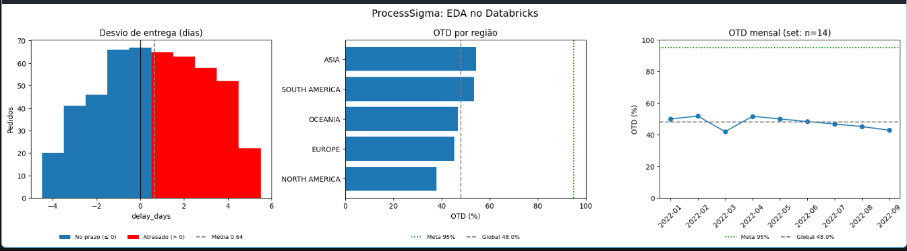
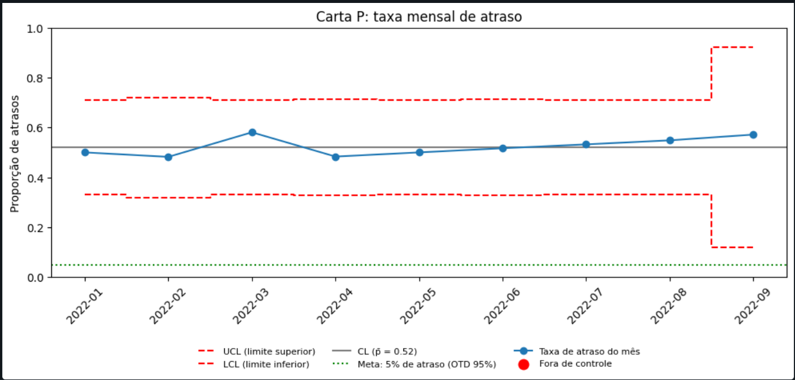
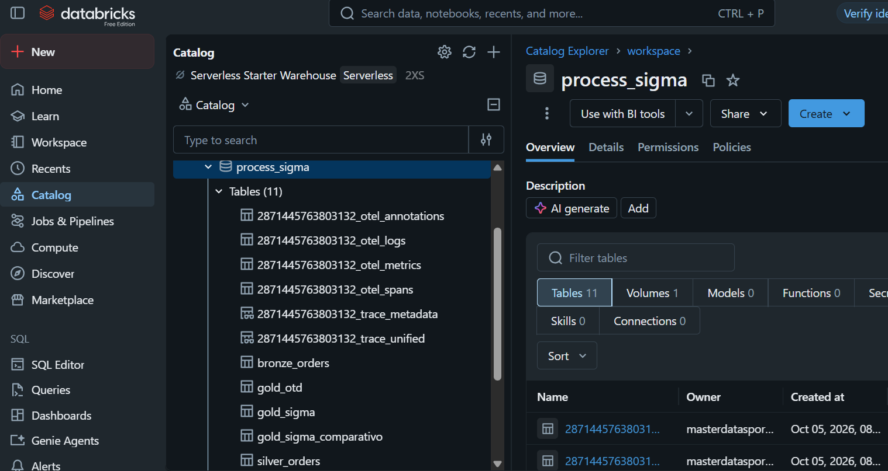
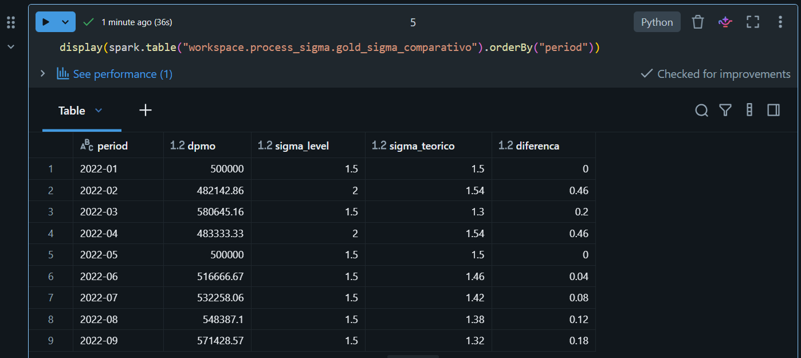

# ⚡ ProcessSigma Framework
### Pipeline de Inteligência de Entregas — Exemplo Minimalista

> **Six Sigma + Engenharia de Dados + Process Mining**
> Um framework leve para aplicar a metodologia DMAIC em qualquer conjunto de dados operacionais, com dois caminhos de execução: **local (pandas)** e **Databricks (Delta)**.

> *Abra o Projeto Online clicando no botão abaixo:*

[](https://process-sigma-framework.streamlit.app/)

---

## Problema

Aplicar Six Sigma em dados reais é mais difícil do que entender a teoria. Este projeto transforma um CSV de entregas em indicadores de qualidade acionáveis e responde a quatro perguntas:

- O processo entrega no prazo prometido (OTD) e quão longe está da meta?
- O atraso é sistemático ou aleatório?
- O problema é regional ou do processo como um todo?
- O processo é estatisticamente estável?

## Solução

```text
CSV  ->  Bronze  ->  Silver  ->  Gold  ->  EDA  ->  Carta P  ->  Resumo executivo
```

| Etapa | O que faz |
|---|---|
| 🥉 Bronze | Ingestão bruta, dados preservados como chegam |
| 🥈 Silver | Limpeza, deduplicação, cálculo de atraso |
| 🥇 Gold | OTD%, DPMO, Nível Sigma por período e região |
| 📊 EDA | Distribuição do atraso, OTD por região, tendência mensal |
| 📈 CEP | Carta P com detecção automática de pontos fora de controle |
| 🎯 Business Case | Resumo executivo com recomendação |

O repositório oferece **dois caminhos** para o mesmo resultado:

- **Opção A, local:** notebook + dashboard Streamlit, a partir de um CSV, sem banco de dados.
- **Opção B, Databricks:** as mesmas camadas como tabelas Delta, um notebook por camada.

O projeto completo (privado) inclui Arquitetura Medalhão no Supabase, dashboard em tempo real com 5 páginas, análise estatística em R, Process Mining com PM4Py e dashboard executivo em Power BI.

---

## Resultados

Exemplo com **500 pedidos, 9 meses e 5 regiões**:

| Indicador | Resultado | Meta |
|---|---|---|
| Pedidos atrasados | 260 (52,0%) | — |
| OTD | 48,0% | ≥ 95% |
| DPMO | 520.000 | ≤ 6.210 |
| Nível Sigma | 1,5σ (Critical) | ≥ 4,0σ |
| Atraso médio / desvio | 0,64 dia / 2,43 dias | — |

**O que os dados dizem**

- O erro de prazo é simétrico (para mais e para menos), então o prazo prometido está mal calibrado.
- O OTD é parecido em todas as regiões: o problema é do processo, não de um local.
- A Carta P tem p̄ = 0,52 e 0 pontos fora de controle: o processo é **estável, porém crítico** (problema crônico).
- Setembro tem só 14 pedidos, então esse ponto pesa pouco na leitura.





---

## Como rodar

### Opção A: local (pandas)

#### 1. Clonar o repositório
```bash
git clone https://github.com/moises-rb/process-sigma-framework
cd process-sigma-framework
```

#### 2. Criar ambiente com uv (recomendado)
```bash
# Instalar uv (se ainda não estiver instalado)
powershell -ExecutionPolicy ByPass -c "irm https://astral.sh/uv/install.ps1 | iex"

# Criar ambiente com Python 3.11
uv venv --python 3.11
.venv\Scripts\activate        # Windows
source .venv/bin/activate     # Linux/Mac

# Instalar dependências (cerca de 1 minuto)
uv pip install -r requirements.txt
```

Alternativa com pip:
```bash
python -m venv .venv
.venv\Scripts\activate
pip install -r requirements.txt
```

#### 3. Adicionar seus dados
Coloque seu CSV na pasta `data/` seguindo o formato do template, ou deixe o notebook gerar dados sintéticos automaticamente.

#### 4. Executar o notebook
```bash
jupyter notebook minimal_example.ipynb
```

> **Pré-requisito para exportar os PNGs:** o notebook salva os gráficos em `exports/` usando o Kaleido, que precisa do **Google Chrome** (ou Chromium). Se não tiver, rode `kaleido_get_chrome` com o ambiente ativo.

#### 5. Executar o dashboard
```bash
streamlit run minimal_example_app.py
```

### Opção B: Databricks Free Edition (serverless)

Pré-requisito: uma conta na Databricks Free Edition.

1. **Criar a estrutura de dados.** Em um notebook novo, rode:
   ```sql
   CREATE SCHEMA IF NOT EXISTS workspace.process_sigma;
   CREATE VOLUME IF NOT EXISTS workspace.process_sigma.raw;
   ```
2. **Subir o CSV.** Em **Catalog → workspace → process_sigma → raw**, use *Upload to this volume* e envie `data/template_injecao.csv`.
3. **Importar os notebooks.** Em **Workspace → Import**, importe os arquivos da pasta `databricks/`.
4. **Rodar na ordem:** Bronze, Silver, Gold e EDA. Cada notebook lê a tabela da camada anterior.

Tabelas Delta geradas em `workspace.process_sigma`:

| Camada | Tabela |
|---|---|
| Bronze | `bronze_orders` |
| Silver | `silver_orders` |
| Gold | `gold_otd`, `gold_sigma`, `gold_sigma_comparativo` |



> **Atenção ao gráfico 3.** No caminho local, o PNG `sigma_evolution` mostra o σ mensal. No EDA do Databricks, o gráfico 3 é o **OTD mensal**. São visões diferentes do mesmo dado.

---

## Decisões de projeto

**Bronze**
- Colunas em `snake_case`, porque o Delta recusa espaços e parênteses nos nomes.
- Acrescenta `source` e `ingested_at`. Nenhum cálculo: a Bronze guarda o dado como chegou.

**Silver**
- Tipagem com funções `try_`, que viram `NULL` quando a conversão falha em vez de derrubar o notebook.
- Cria `delay_days`, `is_late`, `period`, `damage_flag` e `return_flag` (esta fixa em `False` neste exemplo).
- Remove nulos e duplicados.

**Definição de defeito**

Defeito = `days_real > days_scheduled`. As colunas `delivery_status` e `late_delivery_risk` do CSV discordam dos dias reais em 238 e 257 dos 500 pedidos. A conclusão não muda com nenhuma das três definições: o OTD fica entre 46% e 50%.

**Nível Sigma: função original contra valor teórico**

A função `dpmo_to_sigma` original foi replicada e bate nos 9 meses. Ao lado dela, a coluna `sigma_teorico` (z da taxa de acerto, mais o deslocamento convencional de 1,5) fica na tabela `gold_sigma_comparativo`.

A função original devolve níveis **em degraus** e arredonda para o lado otimista. Em fevereiro e abril, ela mostra 2,0σ contra 1,54σ teórico. No resultado geral a diferença é pequena (1,5σ contra cerca de 1,45σ).



---

## Estrutura do Projeto

```text
process-sigma-framework/
├── minimal_example.ipynb       # Notebook narrativo (caminho local)
├── minimal_example_app.py      # Dashboard Streamlit standalone
├── export_graphs.py            # Exporta os 4 gráficos para exports/
├── requirements.txt            # Dependências com versões fixas
├── data/
│   └── template_injecao.csv    # Template de dados
├── databricks/                 # Notebooks do caminho Databricks (um por camada)
├── exports/                    # Gráficos gerados (PNG)
└── docs/
    ├── ANALISE_GUIDE.md        # Guia de leitura da análise
    ├── LINKEDIN_POST.md        # Texto de divulgação
    └── img/                    # Prints do Databricks usados neste README
```

---

## Requisitos Mínimos de Dados

| Análise | Mínimo | Recomendado |
|---|---|---|
| EDA | 30 registros | 200+ |
| Carta P | 25 subgrupos | 30+ |
| Cpk | 100 registros | 500+ |
| Nível Sigma | 100 oportunidades | 1.000+ |

---

## Replicável para Qualquer Segmento

O framework requer 5 campos para rodar:

| Campo | Tipo | Descrição |
|---|---|---|
| `order_id` | Integer | ID único do evento |
| `order_date` | Date | Data de início do processo |
| `days_scheduled` | Integer | Lead time planejado |
| `days_real` | Integer | Lead time real |
| `order_region` | Text | Segmento usado nos recortes (região, equipe, unidade) |

`ship_date` pode estar no CSV, mas não entra nos cálculos.

**Segmentos aplicáveis:** Logística, Saúde (Healthcare), Service Desk de TI, RH, Construção, Finanças, Manufatura. Em cada um, o que muda é a definição de "defeito".

---

## O que aprendi

<!-- PREENCHER na fase de explicação, com suas palavras: 3 aprendizados (um técnico, um de método e uma decisão com o motivo). -->

_Em breve._

---

## Limitações e próximos passos

- O dashboard aceita upload `.xlsx`, mas o carregador usa `read_csv`: o upload de Excel provavelmente falha.
- A lógica (`dpmo_to_sigma`, `classify_sigma`, limpeza) está duplicada entre o notebook e o app, e não há testes automatizados.
- `classify_sigma` tem 5 faixas, e as tabelas de referência têm 6.
- Testes de hipótese, Cpk e Process Mining existem só no projeto completo (privado).

---

## Stack


---

## Licença

Licenciado sob a **Business Source License 1.1 (BSL 1.1)**.
Grátis para uso não comercial. Uso comercial requer autorização.
Converte-se em MIT após 4 anos.

---

## Projeto Completo & Consultoria

Interessado no pipeline completo ou em aplicar isso ao seu negócio?
Connect on [LinkedIn](https://www.linkedin.com/in/moisesrsjr/)

---

*ProcessSigma — Onde os Dados Encontram a Excelência de Processos*
